# GadgetBekas

Toko HP bekas online: katalog yang jujur untuk pembeli, dan halaman admin yang praktis untuk penjual. Dibuat dengan Laravel 12.

> Gambar di bawah diambil dari aplikasi yang berjalan dengan data contoh fiktif. 21 tes otomatis lulus di Windows dan Linux (PHP 8.3).

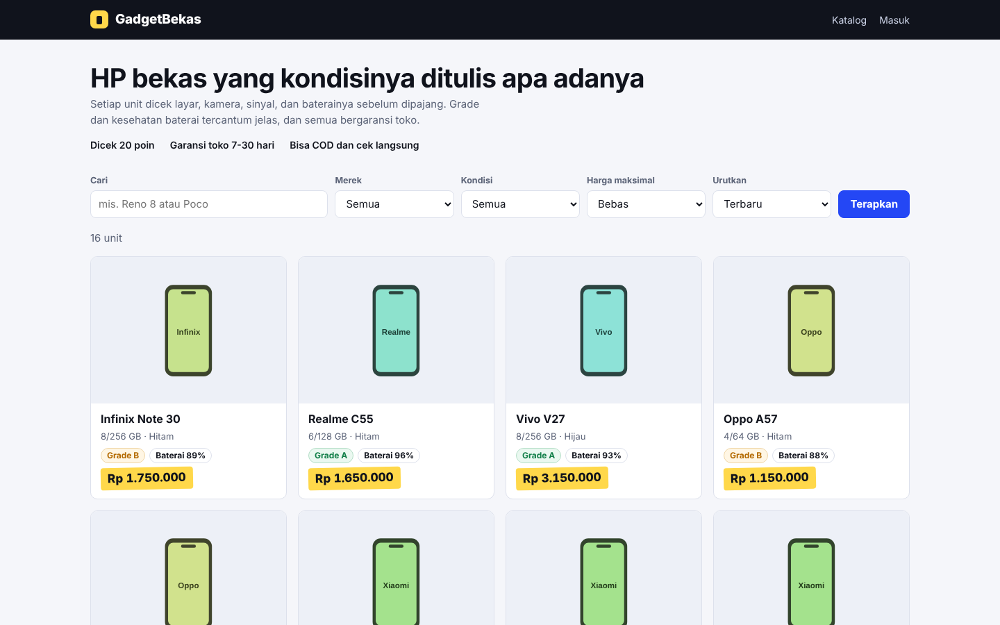

## Kenapa dibuat

Orang yang menjual HP bekas biasanya memakai chat dan status WhatsApp. Foto tercecer, harga berubah-ubah, dan pembeli harus bertanya satu-satu: baterainya berapa persen, ada garansi atau tidak, masih ada atau sudah laku. Penjualnya sendiri sulit melacak stok dan modal.

GadgetBekas memindahkan itu ke satu katalog. Pembeli langsung melihat grade, kesehatan baterai, dan kelengkapan tiap unit, lalu bertanya lewat tombol WhatsApp yang sudah berisi nama unit dan harganya. Penjual mengelola stok, foto, dan harga modal dari satu halaman admin.

## Apa yang jadi lebih mudah

**Untuk pembeli**
- Cari dan saring berdasarkan merek, grade, harga maksimal, atau baterai terbaik.
- Informasi lengkap di halaman unit, tanpa perlu bertanya satu-satu.
- Satu klik ke WhatsApp penjual, pesan sudah terisi.

**Untuk penjual**
- Lihat jumlah unit tersedia, nilai stok, serta omzet dan laba bulan ini.
- Tandai terjual atau dipesan dengan satu tombol. Tanggal terjual terisi sendiri.
- Harga modal dan IMEI hanya terlihat di admin, tidak pernah tampil di katalog.

## Tampilan katalog

| Semua unit | Filter merek, termurah |
|---|---|
|  | 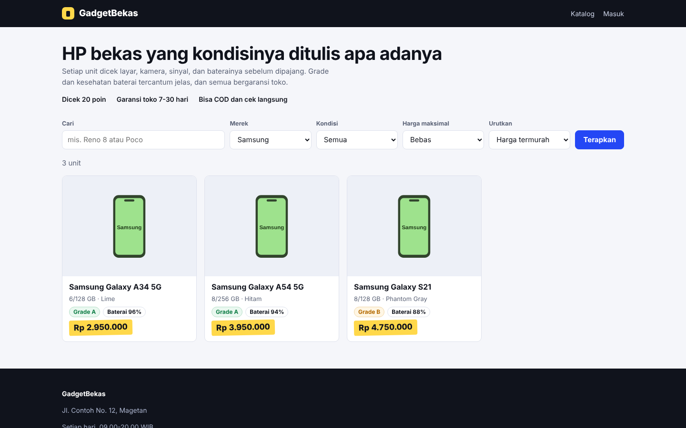 |

| Grade A, baterai terbaik | Halaman unit |
|---|---|
| 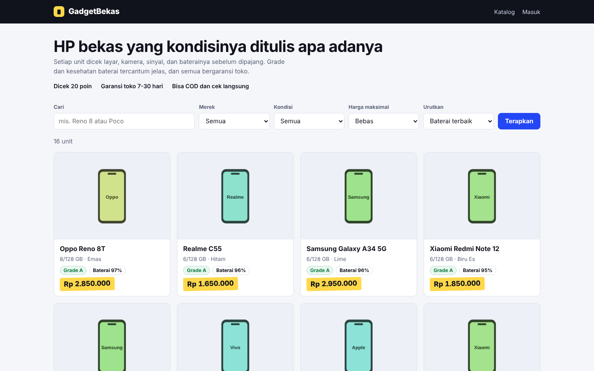 | 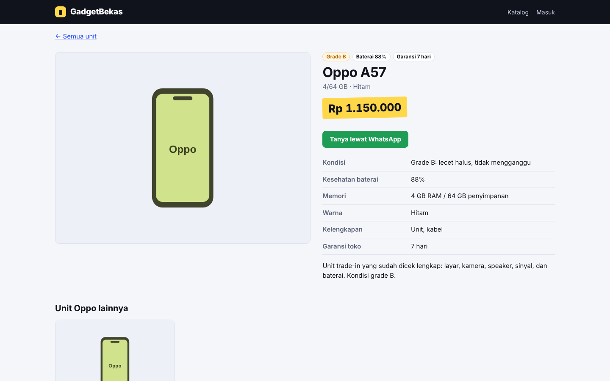 |

| Di ponsel (katalog) | Di ponsel (unit) |
|---|---|
| 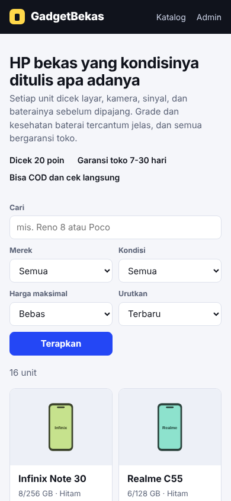 | 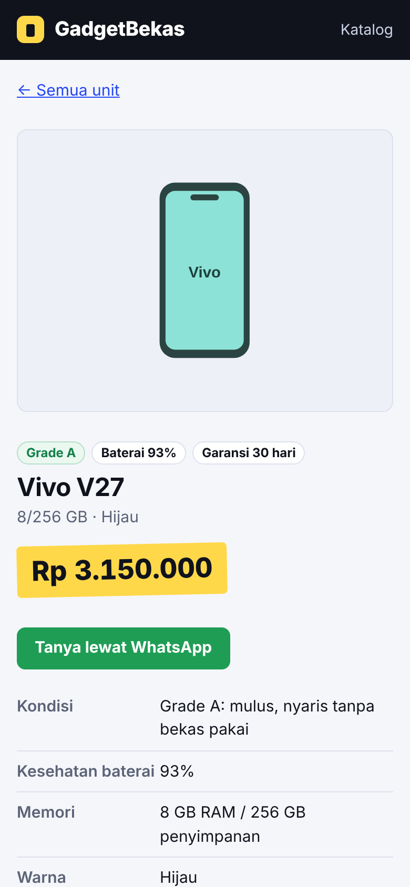 |

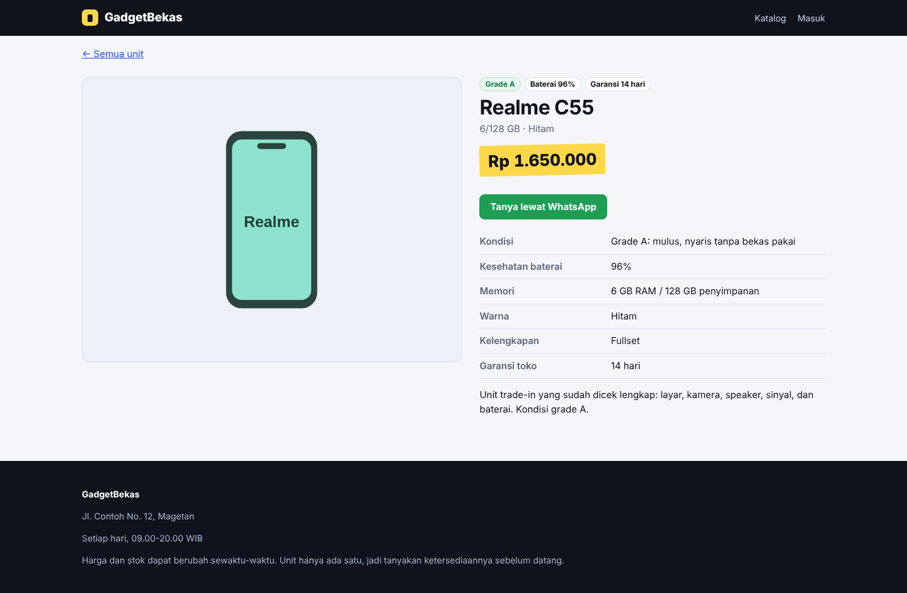

Unit tanpa foto memakai siluet HP berwarna sesuai merek, jadi katalog tetap rapi.

## Tampilan admin

| Masuk | Ringkasan |
|---|---|
| 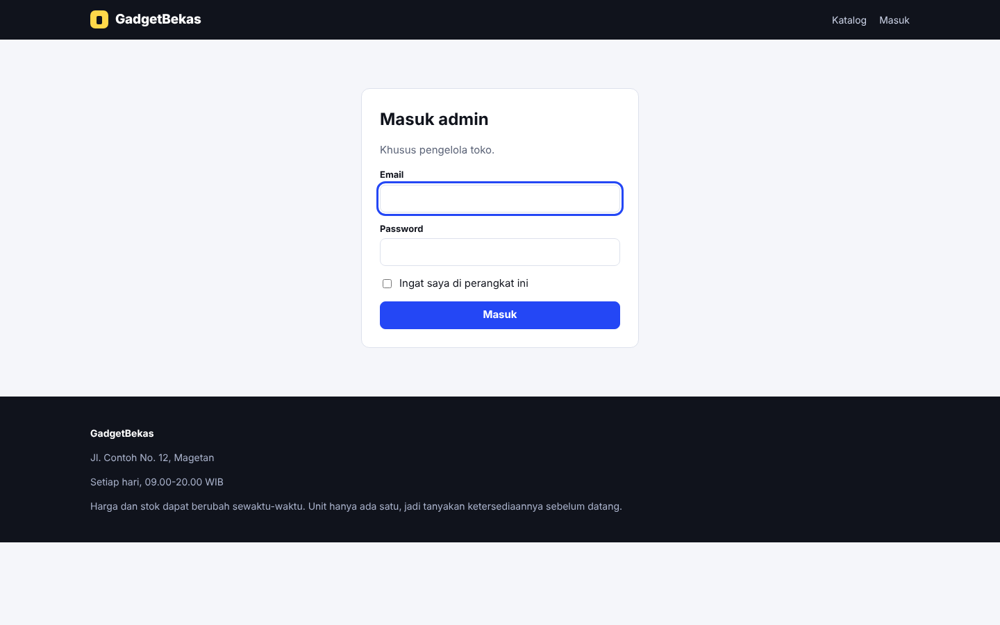 |  |

| Daftar produk | Cari produk |
|---|---|
| 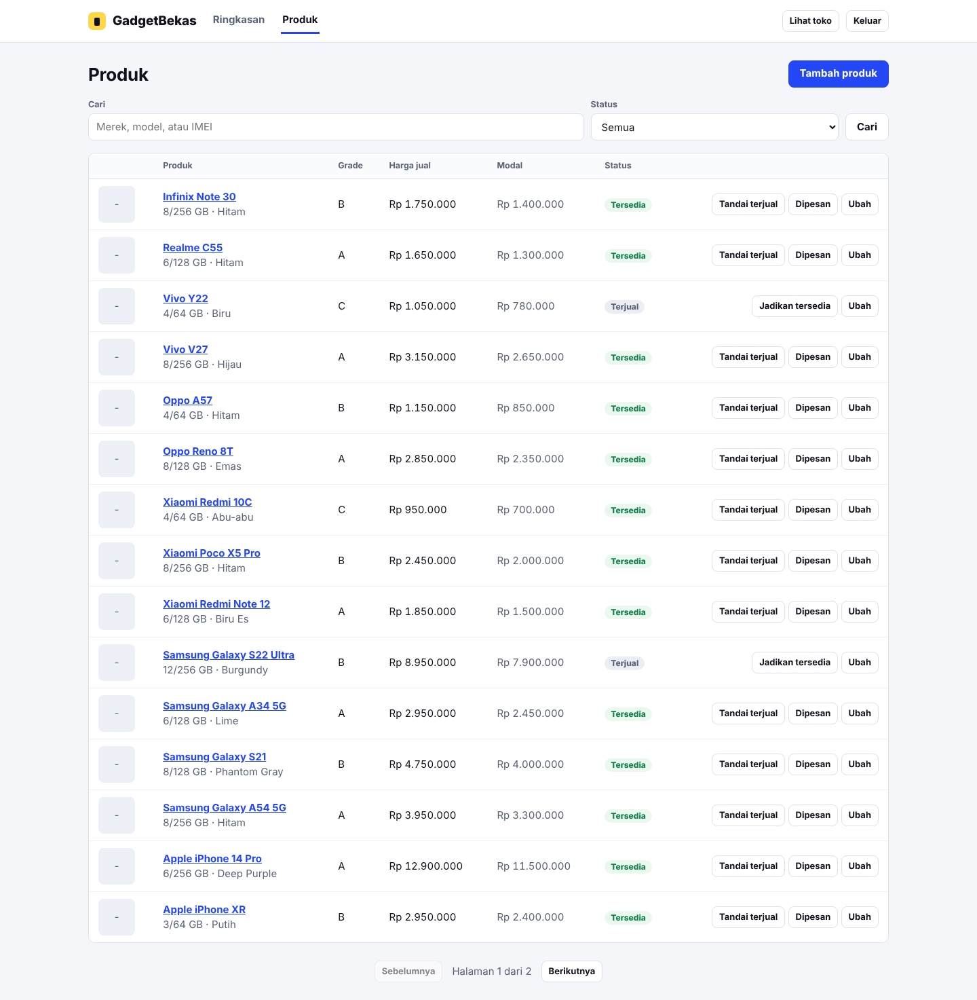 | 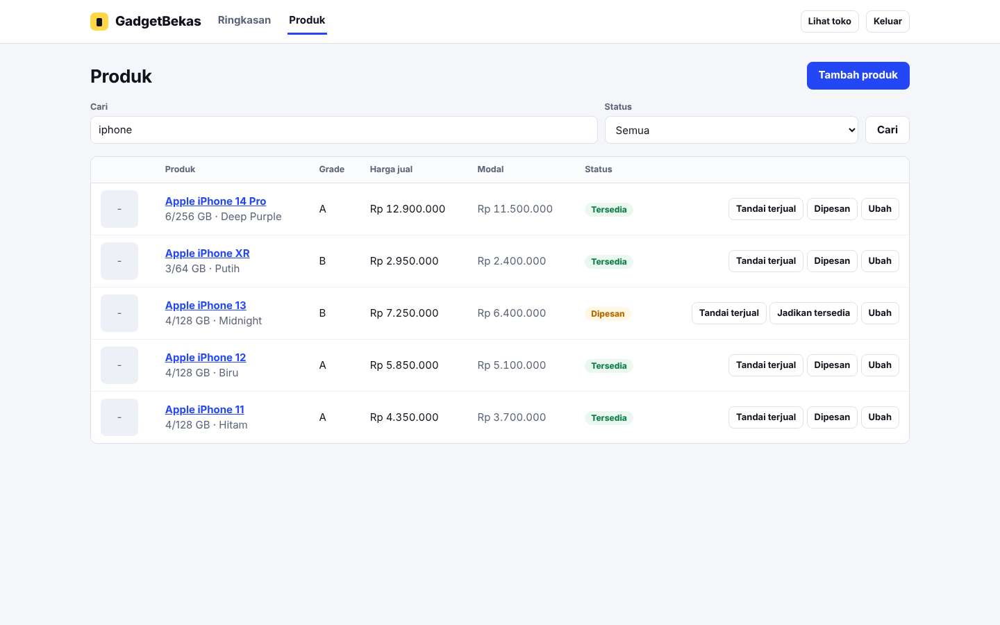 |

| Tambah produk | Ubah produk |
|---|---|
| 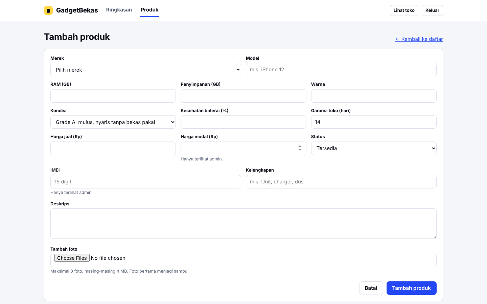 | 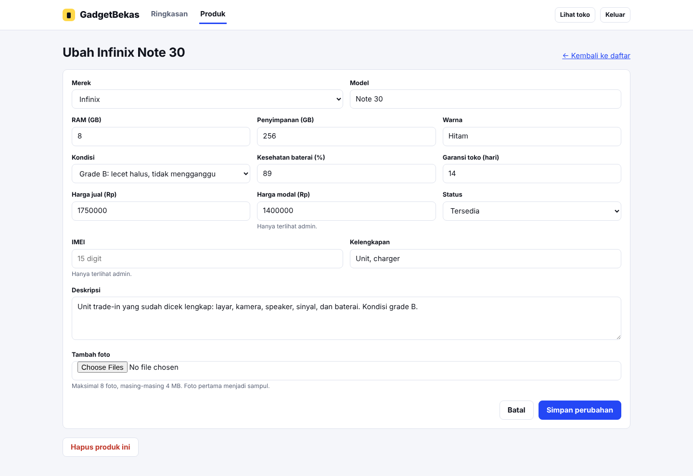 |

Tombol cepat **Tandai terjual**, **Dipesan**, dan **Jadikan tersedia** ada di tiap baris.

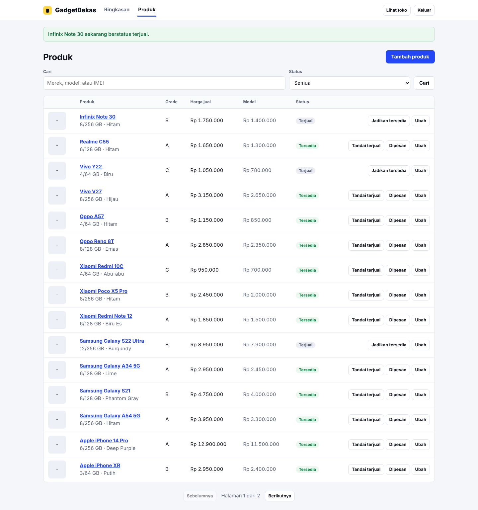

Angka di ringkasan ikut berubah setelah ada unit yang terjual.

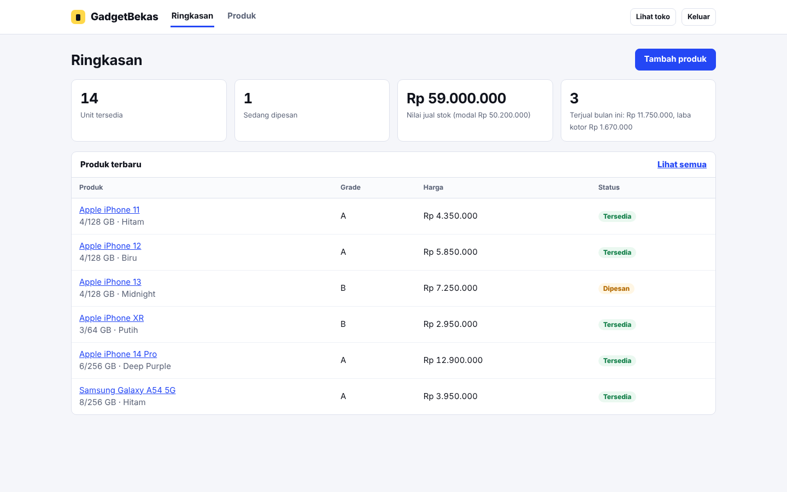

## Mencoba

Butuh PHP 8.2 atau lebih baru dan Composer.

```bash
composer install
cp .env.example .env
php artisan key:generate
touch database/database.sqlite
php artisan migrate --seed       # 18 unit contoh dan akun admin
php artisan storage:link
php artisan serve                # http://localhost:8000
```

Admin masuk di `/masuk` dengan akun dari `.env` (bawaan `admin@gadgetbekas.test` / `ganti-password-ini`; ganti sebelum dipakai sungguhan). Nomor WhatsApp, nama, dan alamat toko diatur lewat `SHOP_*` di `.env`. Tes dijalankan dengan `php vendor/bin/phpunit`.

## Teknologi

Laravel 12, SQLite, Blade dengan CSS biasa (tanpa Vite atau npm). Admin dilindungi login dengan pembatasan percobaan, upload foto dibatasi tipe dan ukuran, dan pencarian memakai parameter terikat.

## Kontak

Ardha Febrian Muqorrobin, [asammanis89.github.io](https://asammanis89.github.io). Lisensi MIT.
